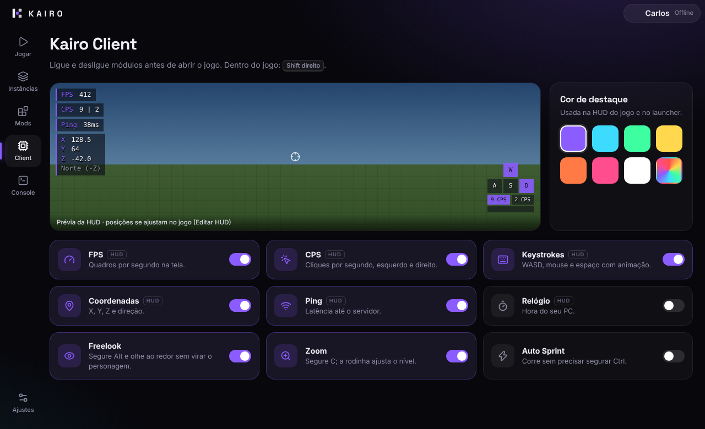

  <b>Launcher de Minecraft com client próprio, focado em PvP.</b> 
  Rápido, bonito e sem complicação — instala o jogo, o Java e os mods sozinho.

  <a href="https://github.com/CarlosBR177/Kairo-Launcher/releases/latest"><b>⬇ Baixar para Windows</b></a>

## O que tem

**No launcher**
- **Instala tudo sozinho:** Minecraft, Fabric e o Java certo para cada versão. É só criar uma instância e clicar em Jogar.
- **Instâncias separadas:** cada uma com seus próprios mods, mundos e configurações.
- **Mods do Modrinth** direto no launcher: busque, instale (com dependências), ligue e desligue.
- **Pacote de desempenho** automático (Sodium, Lithium, FerriteCore e outros) para ganhar FPS sem configurar nada.
- **Servidores favoritos** na tela inicial, com ping ao vivo e jogadores online. Um clique e você já entra.
- **Mostra no Discord** o que você está jogando.
- **Se atualiza sozinho** quando sai versão nova.

**No jogo (Kairo Client)**
- **HUD:** FPS, CPS, keystrokes, coordenadas, ping, relógio, efeitos de poção, armadura com durabilidade, contador de itens (pérolas, maçãs, poções, flechas, totens) e combo/distância do último hit.
- **Monte sua HUD do seu jeito:** arraste cada elemento para onde quiser e mude o tamanho — no jogo (tecla **H**) ou no launcher.
- **Mira personalizada:** estilo, tamanho, espaço, espessura e cor.
- **Visual:** fogo mais baixo, tamanho e posição do item na mão (escudo mais baixo), brilho máximo, partículas de hit.
- **Movimento e câmera:** freelook, zoom suave, auto sprint e toggle sneak.
- **Perfis:** salve combinações de módulos (PvP, Survival, Gravação…) e troque com um clique.
- **Regras por servidor:** desligue sozinho os módulos que um servidor não permite.

> **Jogo limpo:** o Kairo não tem nada que dê vantagem injusta — sem reach, autoclicker, hitbox ou ver através de blocos. Mesmo assim, cada servidor tem suas regras; na dúvida, confira antes de jogar.

## Instalar

1. Baixe o **`Kairo-Setup.exe`** na página de [Releases](https://github.com/CarlosBR177/Kairo-Launcher/releases/latest).
2. Abra e clique em **Instalar** — leva só alguns segundos e não pede senha de administrador. Em **Opções de instalação** dá para escolher a pasta e se quer atalho na Área de Trabalho.
3. Se o Windows mostrar **"O Windows protegeu o computador"**, clique em **Mais informações → Executar assim mesmo**. Isso aparece porque o instalador ainda não tem assinatura digital paga; não é vírus.
4. No final, clique em **Abrir o Kairo**. Depois ele fica no menu Iniciar.

O mesmo `Kairo-Setup.exe` também atualiza uma instalação antiga — seus mundos e contas continuam lá.

Requisitos: Windows 10 ou 11 (64 bits). Não precisa instalar Java — o launcher baixa sozinho.

## Primeiros passos

1. **Entre na sua conta:** clique em **Entrar** no canto superior direito.
   - **Conta Microsoft** (a do Minecraft original): o launcher mostra um código; abra o link, digite o código e faça login no site da Microsoft. O launcher nunca vê sua senha.
   - **Conta offline:** só um nome, para jogar singleplayer ou em servidores que aceitam contas não originais.
2. **Crie uma instância:** escolha a versão do Minecraft e deixe **Fabric** marcado para usar o Kairo Client.
3. Clique em **Jogar**. Na primeira vez ele baixa o jogo e o Java, o que leva alguns minutos.

## Atalhos no jogo

| Tecla | O que faz |
|---|---|
| **Shift direito** | Menu do Kairo (ligar/desligar módulos, trocar perfil) |
| **H** | Editor de HUD (mover e redimensionar) |
| **Alt** (segurar) | Freelook — olhar ao redor sem virar o personagem |
| **C** (segurar) | Zoom — a rodinha do mouse ajusta |

Todas as teclas podem ser trocadas em **Opções → Controles → Kairo Client**.

**Editor de HUD:** clique num elemento para selecionar, arraste para mover e use a rodinha (ou a alça no canto) para mudar o tamanho. A barra embaixo tem posições rápidas (cantos, centro), ocultar e redefinir.

## Versões do Minecraft

O launcher roda qualquer versão do Minecraft. O **Kairo Client** (HUD e módulos) funciona em:

**1.21.1 · 1.21.4 · 1.21.6–1.21.8 · 1.21.11 · 26.3**

Em outras versões o jogo abre normalmente, só sem os módulos do Kairo.

## Dúvidas

**Posso usar meus próprios mods?**
Sim. Na aba **Mods**, busque no Modrinth ou coloque arquivos `.jar` na pasta da instância (botão de pasta na tela inicial).

**Minha conta offline não entra no servidor.**
Contas offline só entram em servidores com `online-mode=false`. Para servidores normais, use sua conta Microsoft.

**Onde ficam meus mundos e configurações?**
Em `%APPDATA%\KairoLauncher\instances\<nome-da-instância>`. O botão de pasta na tela inicial abre direto ali.

**Como desinstalar?**
Em **Configurações → Aplicativos** do Windows. Seus mundos ficam em `%APPDATA%\KairoLauncher` até você apagar a pasta.

**O jogo fechou com erro.**
Abra a aba **Console** do launcher, copie as linhas em vermelho e [abra uma issue](https://github.com/CarlosBR177/Kairo-Launcher/issues) com elas.

## Aviso

O Kairo não é um produto oficial do Minecraft e não tem ligação com a Mojang ou a Microsoft. O jogo é baixado direto dos servidores oficiais da Mojang e nunca é distribuído modificado, respeitando o [EULA do Minecraft](https://www.minecraft.net/eula). Os mods do pacote de desempenho vêm do Modrinth, de seus próprios autores.

---

Quer compilar o projeto ou contribuir? Veja o [guia de desenvolvimento](docs/DESENVOLVIMENTO.md).
