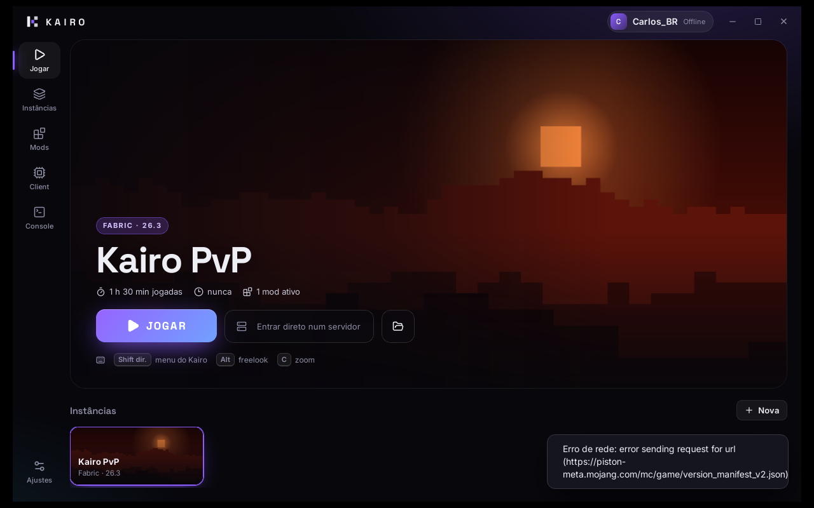

<p align="center"></p>

# Kairo

Launcher de Minecraft com client próprio, focado em PvP.



São duas partes:

| Pasta | O que é | Tecnologia |
|---|---|---|
| `launcher/` | O launcher (interface, contas, instalação, mods, instalador .exe) | Tauri 2 + Rust + React |
| `launcher/core/` | Núcleo do launcher, sem interface (testável sozinho) | Rust |
| `mod/` | **Kairo Client**: mod com HUD, CPS, FPS, keystrokes, freelook, zoom… | Fabric · Stonecutter · MC 1.21.1–26.3 |
| `branding/` | Logo, símbolo e ícone em SVG/PNG | — |

## O que já faz

**Launcher**
- Login **Microsoft** (código de dispositivo, sem ver a senha) e contas **offline**.
- Instâncias separadas (mods, mundos e configs próprios), com capas geradas.
- Instala sozinho: Minecraft, Fabric, bibliotecas, assets **e o Java certo** (o mesmo runtime do launcher oficial).
- Mods pelo **Modrinth** (busca, instala com dependências, liga/desliga, remove).
- **Pacote de desempenho** automático: Sodium, Lithium, FerriteCore, ImmediatelyFast, EntityCulling, ModernFix.
- Flags de JVM ajustadas para cliente (G1 otimizado ou ZGC; compact object headers no Java 25).
- Aba **Client**: liga/desliga os módulos, ajusta as opções de cada um (editor de mira com prévia), **monta o layout da HUD arrastando e redimensionando na prévia** e troca a cor **antes** de abrir o jogo.
- **Perfis de HUD** (PvP, Survival, Gravação…): salve quais módulos ficam ligados e troque com um clique, no launcher ou no jogo.
- **Regras por servidor**: escolha módulos que são desligados sozinhos em servidores que os proíbem (e voltam ao sair).
- **Servidores favoritos** na tela inicial com ping ao vivo, jogadores online, MOTD e ícone (resolve SRV como o jogo).
- **Discord Rich Presence**: instância, versão e servidor no seu perfil.
- **Atualização automática** pelas Releases do GitHub (assinada).
- Quick Play (entrar direto num servidor), console com filtro de erros, tempo jogado.
- Instalador NSIS em português, por usuário (não pede administrador).

**Kairo Client (mod)**
- HUD: FPS, CPS (esq. | dir.), Keystrokes animado, Coordenadas + direção, Ping, Relógio.
- PvP: **Combo e distância do último hit** (só mostra), **Efeitos de poção** com tempo, **Armadura** com durabilidade, **Contador de itens** (pérolas, maçãs, poções, flechas, totens), **Mira personalizada**, **Partículas de hit**.
- Visual: **Fogo baixo**, **Item na mão** (tamanho/posição, escudo baixo), **Brilho máximo**.
- Freelook (segure **Alt**), Zoom suave (segure **C**, rodinha ajusta), Auto Sprint, **Toggle Sneak**.
- Menu no jogo: **Shift direito** (com troca de perfil).
- **Editor de HUD** (tecla **H**, ou "Editar HUD" no menu): arraste para mover, rodinha ou alça do canto para mudar o tamanho (50%–300%), posições rápidas (cantos, bordas, centro), ocultar/mostrar e redefinir. As posições são relativas à tela, então o layout fica igual em qualquer resolução.
- Nada que dê vantagem injusta: sem reach, autoclicker, hitbox ou ver através de blocos.
- Config em `config/kairo.json` — o launcher lê e grava o mesmo arquivo.


## Gerar o instalador (jeito fácil: GitHub)

1. Suba esta pasta para um repositório no GitHub.
2. *Actions* → **Build Kairo** → *Run workflow*.
3. Baixe o artefato **Kairo-Launcher-Windows**: tem o `Kairo Launcher_0.1.0_x64-setup.exe`.

## Gerar no seu PC (Windows)

Pré-requisitos: [Rust](https://rustup.rs), [Node 22+](https://nodejs.org), [JDK 25](https://adoptium.net) (o Gradle baixa o JDK 21 das 1.21.x sozinho) e o *Build Tools do Visual Studio* (C++). O WebView2 já vem no Windows 10/11.

```powershell
# 1) mod (gera um jar por versão do Minecraft)
cd mod
.\gradlew.bat build
copy versions\*\build\libs\kairo-client-*.jar ..\launcher\src-tauri\resources\
del ..\launcher\src-tauri\resources\*-sources.jar

# 2) launcher
cd ..\launcher
npm install
npm run tauri dev          # abre em modo desenvolvimento
npm run tauri build        # gera o .exe em src-tauri\target\release\bundle\nsis\
```

Só a interface, no navegador (dados de exemplo, sem Rust): `npm run dev` → http://localhost:1420

Testar o mod direto, sem o launcher: `cd mod && .\gradlew.bat :26.3:runClient` (ou `:1.21.8:runClient` etc.).

## Várias versões do Minecraft (Stonecutter)

O mod usa [Stonecutter](https://stonecutter.kikugie.dev/): um código só, e um jar por versão.

| Jar | Carrega em | Loom | Java |
|---|---|---|---|
| `kairo-client-0.1.0+1.21.1.jar` | 1.21 – 1.21.1 | remap (mapeamentos Mojang) | 21 |
| `kairo-client-0.1.0+1.21.4.jar` | 1.21.4 | remap | 21 |
| `kairo-client-0.1.0+1.21.8.jar` | 1.21.6 – 1.21.8 | remap | 21 |
| `kairo-client-0.1.0+1.21.11.jar` | 1.21.11 | remap | 21 |
| `kairo-client-0.1.0+26.3.jar` | 26.3.x | sem ofuscação | 25 |

- O código-fonte fica escrito para a **26.3** (versão "ativa"). Trechos que mudam entre versões usam comentários do Stonecutter:
  ```java
  //? if >=26.1 {
  raw.text(font, s, x, y, color, shadow);
  //?} else {
  /*raw.drawString(font, s, x, y, color, shadow);
  *///?}
  ```
- Para editar/rodar outra versão na IDE, use a tarefa Gradle **Set active project to 1.21.8** (e volte para 26.3 antes de commitar).
- As diferenças ficam concentradas em `compat/Gfx.java` (desenho), `compat/Compat.java` (telas, teclas), `KairoClient` (registro de HUD e teclas), nas duas telas e nos mixins de zoom/mira/rolagem.
- Versões específicas (Fabric API, faixa de versões do jogo) ficam em `mod/versions/<versão>/gradle.properties`.
- O launcher escolhe o jar pela versão da instância (`kairo_jar_for` em `lib.rs`). Para adicionar uma versão: inclua em `settings.gradle.kts`, crie `versions/<versão>/gradle.properties` e acrescente a linha em `kairo_jar_for` e em `kairoSupports` (`launcher/src/modules.ts`).

## Login Microsoft (Client ID do Azure)

Sem isso o launcher funciona só com contas offline. É gratuito, mas a Mojang precisa aprovar:

1. [portal.azure.com](https://portal.azure.com) → **App registrations** → *New registration*.
   - Tipo de conta: **Personal Microsoft accounts only**.
2. Em **Authentication** → *Advanced settings* → **Allow public client flows = Yes** (habilita o device code).
3. Copie o **Application (client) ID**.
4. Peça acesso à API do Minecraft no formulário da Mojang: https://aka.ms/mce-reviewappid
   (até aprovarem, o login termina com a mensagem “Client ID ainda não foi aprovado”).
5. Compile com a variável: `set KAIRO_MS_CLIENT_ID=seu-client-id` antes do `npm run tauri build`
   — ou crie o secret `KAIRO_MS_CLIENT_ID` no GitHub para o workflow.

O Client ID não é segredo (vai dentro do app), mas é seu: não reutilize o de outros launchers.

## Discord Rich Presence

1. [discord.com/developers/applications](https://discord.com/developers/applications) → *New Application* → nome **Kairo**.
2. Copie o **Application ID**.
3. Em *Rich Presence → Art Assets*, envie `branding/kairo-icon-1024.png` com o nome **kairo**.
4. Compile com `set KAIRO_DISCORD_APP_ID=seu-id` — ou crie o secret `KAIRO_DISCORD_APP_ID` no GitHub.

Sem o ID, a opção aparece desativada em Ajustes e nada é enviado ao Discord.

## Atualização automática

O launcher procura `latest.json` na última Release do repositório. Para publicar uma versão:

1. No GitHub, crie os secrets `TAURI_SIGNING_PRIVATE_KEY` (conteúdo de `.secrets/kairo-updater.key`) e `TAURI_SIGNING_PRIVATE_KEY_PASSWORD` (vazio).
2. Suba a versão em `launcher/src-tauri/tauri.conf.json` e `launcher/package.json` (ex.: `0.2.0`).
3. `git tag v0.2.0 && git push --tags` → o workflow publica a Release com o instalador assinado.

O workflow troca `SEU_USUARIO/SEU_REPO` no `tauri.conf.json` pelo nome do repositório automaticamente. A chave pública já está no `tauri.conf.json`; **a privada (`.secrets/`) nunca deve ir para o Git** — sem ela não dá para publicar atualizações.

## Onde ficam os dados

`%APPDATA%\KairoLauncher\` → `instances\<id>\` (mods, saves, config), `versions\`, `libraries\`, `assets\`, `runtime\` (Java), `settings.json`, `instances.json`, `accounts.json`.

> `accounts.json` guarda os tokens de sessão em texto. Para uso pessoal tudo bem; para distribuir, migre para o Cofre de Credenciais do Windows (crate `keyring`).

## Limitações conhecidas

- O Kairo Client existe para 1.21.1, 1.21.4, 1.21.6–1.21.8, 1.21.11 e 26.3. Outras versões rodam no launcher, mas sem o mod do Kairo.
- Contas offline só entram em servidores com `online-mode=false`.
- O mod ainda não foi compilado nem testado no jogo em nenhuma versão — o primeiro `gradlew build` pode apontar ajustes pequenos de nomes. Os nomes de desenho estão todos em `compat/Gfx.java`, então um nome errado ali se corrige num lugar só. Nas 1.21.x o zoom e a mira usam `require = 0`: se o alvo mudar, eles param de funcionar sem crashar.
- Os mixins de **Fogo baixo** e **Item na mão** usam `require = 0`: se o nome do método mudar numa versão do jogo, o efeito não aparece, mas o jogo abre normalmente.
- Opções finas dos módulos (estilo da mira, tamanho do item…) ficam na aba Client do launcher; no jogo, o menu liga/desliga e troca de perfil.
- Capas, marca do Kairo no tab e nametag própria precisam de um servidor do Kairo e ficaram para depois.
- As capas e o logo são originais; nenhuma marca da Mojang/Microsoft é usada.

## Licença e EULA

O launcher baixa o jogo direto dos servidores da Mojang e nunca distribui o Minecraft modificado, o que respeita o EULA. Os mods do pacote de desempenho são baixados do Modrinth no momento da instalação.
